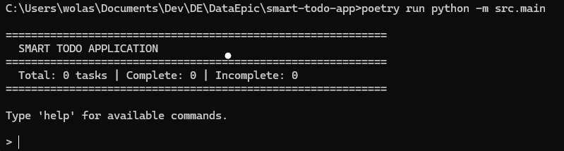
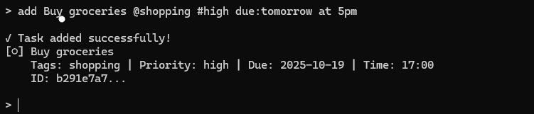
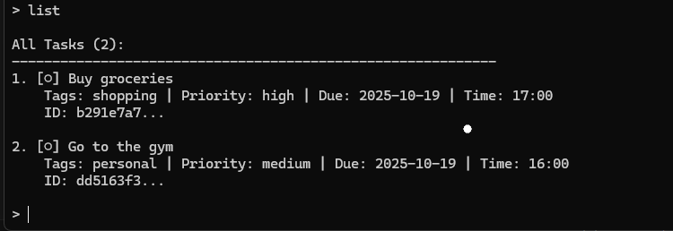
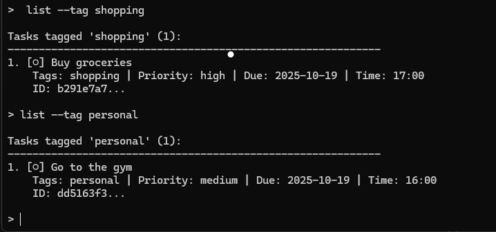
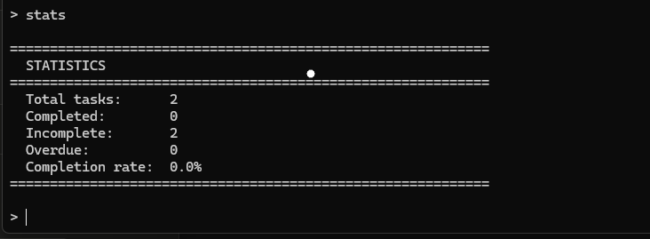
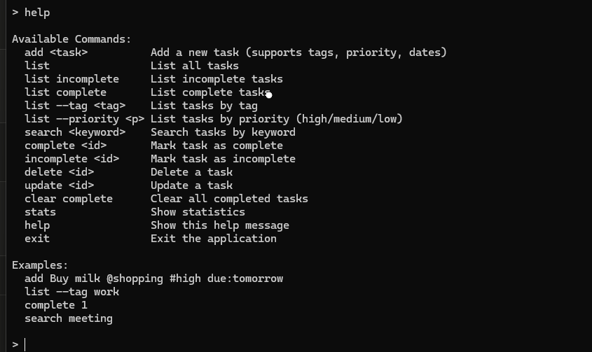
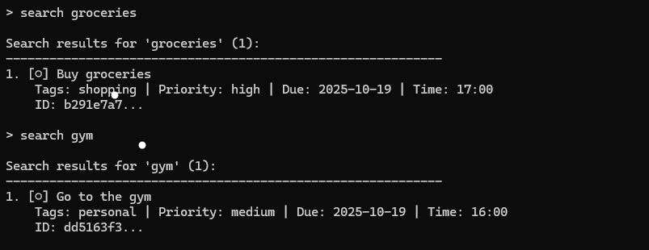
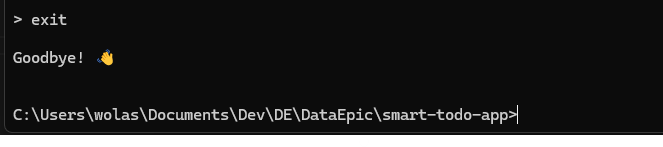

# ⚡ Smart Todo Application

[](https://www.python.org)
[](https://python-poetry.org)
[](https://github.com/psf/black)
[](https://docs.pytest.org)
[](LICENSE)

A powerful, keyboard-centric command-line todo application with advanced natural language parsing, built using Python. Intelligently parses complex entries like `"Buy milk @shopping #high due:tomorrow at 5pm"` and extracts all attributes instantly.

---

## ✨ Features

### 🧠 Intelligent Natural Language Parser
*   **Relative & Absolute Dates**: Recognizes specific dates (`due:2025-10-20`), relative dates (`due:today`, `due:tomorrow`), and offsets (`due:3 days`, `due:2 weeks`).
*   **Contextual Tags**: Organize tasks using custom tags (`@work`, `@shopping`, `@personal`).
*   **Priority Levels**: Elevate key tasks using `#high`, `#medium`, and `#low` priorities.
*   **Task Assignment**: Direct tasks to owners using email formats (e.g. `assigned:john@example.com`).
*   **Precise Time Support**: Schedule down to the minute with 12/24 hour expressions (`at 3pm`, `by 17:00`).

### 💻 Terminal UI & Experience
*   **Dynamic Command Prompt**: A clean shell interface with descriptive prompts, headers, and color conventions.
*   **Partial ID Completion**: Reference tasks by the first few characters of their unique hex IDs (e.g. `complete a1b2`).
*   **Detailed Analytics**: Run `stats` to review completion rates, totals, and overdue counters.
*   **Regex-driven Validation**: Immediate user-friendly feedback on malformed input data.

### ⚙️ Under the Hood
*   **Auto-Save & Atomic Persistence**: All actions write straight to a secure local `tasks.json` file.
*   **Extensive Test Coverage**: Backed by a suite of **200+ unit and integration tests** ensuring `>95%` code coverage.

---

## 📝 NLP Format Syntax

| Attribute | Format / Keyword | Examples | Notes |
| :--- | :--- | :--- | :--- |
| **Tags** | `@tagname` | `@work`, `@shopping` | Case-insensitive, alphanumeric + underscores |
| **Priority** | `#level` | `#high`, `#medium`, `#low` | Controls ordering and priority filters |
| **Due Date** | `due:<value>` | `due:tomorrow`, `due:2025-10-20` | Supports relative keywords and offsets (e.g. `3 days`) |
| **Time** | `at <time>` or `by <time>` | `at 3pm`, `by 14:00` | Supports both 12-hour (am/pm) and 24-hour formats |
| **Assignment** | `assigned:<email>` | `assigned:alice@example.com` | Strictly validates email structure |
| **Duration** | `<number><h\|m>` | `1h`, `30m`, `1h30m` | Tracks projected time expenditure |

---

## 🚀 Quick Start

### Prerequisites
*   **Python 3.10+**
*   **Poetry** (Python package manager)

### Setup & Run
```bash
# 1. Clone the repository
git clone https://github.com/Protagonist01/smart-todo-app.git
cd smart-todo-app

# 2. Install dependencies
poetry install

# 3. Launch the application
poetry run python -m src.main
```

---

## 📸 Visual Walkthrough

<details>
<summary>🖼️ Click to expand screenshot gallery</summary>

| Welcome Screen | Adding a Task |
|:---:|:---:|
|  |  |
| **Listing Tasks** | **Filtering by Tag** |
|  |  |
| **Statistics Dashboard** | **Help Menu** |
|  |  |
| **Search Functionality** | **Exit Application** |
|  |  |

</details>

---

## 💬 Example CLI Session

Below is an example of an interactive session with the Smart Todo application:

```text
$ poetry run python -m src.main

============================================================
  SMART TODO APPLICATION
============================================================
  Total: 0 tasks | Complete: 0 | Incomplete: 0
============================================================

Type 'help' for available commands.

> add Buy groceries @shopping #high due:tomorrow at 5pm

✓ Task added successfully!
[○] Buy groceries
    Tags: shopping | Priority: high | Due: 2025-10-18 | Time: 17:00
    ID: a1b2c3d4...

> add Review PR @work #medium assigned:alice@example.com

✓ Task added successfully!
[○] Review PR
    Tags: work | Priority: medium | Assigned: alice@example.com
    ID: e5f6g7h8...

> list

All Tasks (2):
------------------------------------------------------------
1. [○] Buy groceries
    Tags: shopping | Priority: high | Due: 2025-10-18 | Time: 17:00
    ID: a1b2c3d4...

2. [○] Review PR
    Tags: work | Priority: medium | Assigned: alice@example.com
    ID: e5f6g7h8...

> complete a1b2

✓ Task marked as complete!

> stats

============================================================
  STATISTICS
============================================================
  Total tasks:      2
  Completed:        1
  Incomplete:       1
  Overdue:          0
  Completion rate:  50.0%
============================================================

> exit

Goodbye! 👋
```

---

## 📂 Project Directory Structure

```text
smart-todo-app/
├── src/
│   ├── main.py              # Application entry point
│   ├── cli/
│   │   └── interface.py     # Command-line interface & output loop
│   ├── models/
│   │   ├── task.py         # Task data model & serialization logic
│   │   └── todo_list.py    # TodoList collection manager & querying
│   ├── parsers/
│   │   ├── date_parser.py   # Relative/offset due date parsing utilities
│   │   ├── regex_patterns.py# Base patterns for NLP components
│   │   ├── task_parser.py   # Token parsing coordinator
│   │   └── validator.py     # Schema and field validator rules
│   └── services/
│       ├── storage_service.py # JSON persistence & backup manager
│       └── task_service.py  # Orchestrates CLI requests to models/storage
├── tests/                # Test suite covering parsers, service layers, and models
├── docs/
│   └── architecture.md     # Detailed architecture specifications
├── data/
│   └── tasks.json          # Target storage (auto-generated)
├── pyproject.toml          # Poetry configuration & project dependencies
└── LICENSE                 # Project License (MIT)
```

---

## 🏗️ Architecture

### Data Flow Pipeline
```text
┌────────────┐     ┌───────────────┐     ┌──────────────┐     ┌──────────┐     ┌─────────────────┐
│ User Input │ ──> │ CLI Interface │ ──> │ Task Service │ ──> │ TodoList │ ──> │ Storage Service │
└────────────┘     └───────────────┘     └──────────────┘     └──────────┘     └─────────────────┘
                           │                                       │
                           ▼                                       ▼
                      Task Parser                             Task Model
                           │
                           ▼
               [Validator, Date Parser, Regex]
```

---

## 🛠️ Development & Quality Assurance

### Running Tests
This project is heavily tested to guarantee stability and prevent regressions.

```bash
# Run all tests
poetry run pytest

# Run tests with coverage reports
poetry run pytest --cov=src tests/

# Run a specific test suite
poetry run pytest tests/test_task_parser.py -v
```

### Code Quality & Standards
We maintain high code quality with automated formatters and linters:

```bash
# Auto-format codebase using Black
poetry run black src/ tests/

# Lint with Flake8
poetry run flake8 src/ tests/

# Run static type checks with Mypy
poetry run mypy src/
```

---

## 🤝 Contributing & Conventions

Contributions are welcome! Please follow these steps:
1. Fork the repository.
2. Create a feature branch: `git checkout -b feature/amazing-feature`.
3. Commit changes according to convention: `git commit -m 'feat: add amazing feature'`.
4. Push to the branch: `git push origin feature/amazing-feature`.
5. Open a Pull Request.

### Commit Message Conventions
*   `feat:` - Introduces a new feature.
*   `fix:` - Resolves a bug.
*   `docs:` - Modifies documentation.
*   `test:` - Adds or updates test coverage.
*   `refactor:` - Reworks code structure without changing behavior.

---

## 👤 Author

**Fadeni Taiwo Henry**
*   GitHub: [@Protagonist01](https://github.com/Protagonist01)

---

## 💖 Acknowledgements

*   **Data Epic Team** for project specifications and mentorship.
*   The Python and Poetry open-source communities.
*   Anthropic Claude for assisting in design and development.